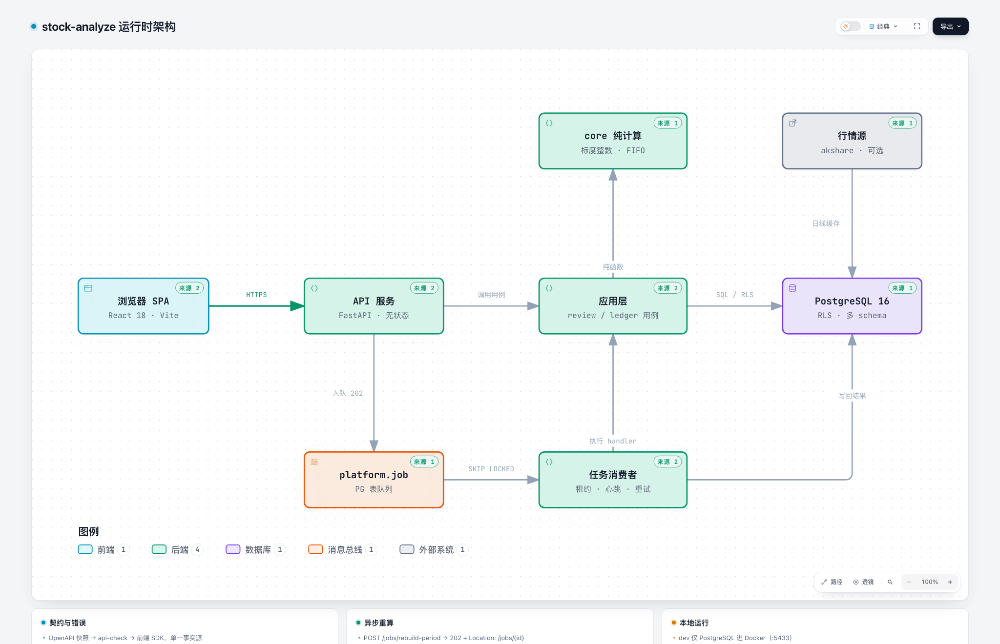

# stock-analyze — 个人交易复盘平台

面向个人投资者的交易复盘系统：导入券商对账单，自动落库/分类/对账，建立 FIFO 回合、净值/资产序列与三域指标，并在 Dashboard 中聚合展示。

> **当前阶段（2026-10-28）**
>
> - **一期**：已完成（认证/多租户/RLS、导入、任务队列、流水维护、契约链路）。
> - **二期核心**：已完成验收或已落地——FIFO 回合、`GET /nav`、资产表、18 指标引擎与 `/metrics`、**Dashboard 两板块（API-084）**、`POST /jobs/rebuild-period`（API-083）。
> - **二期剩余**：归因、月报、导出、设置增强、报告/导出前端页按计划**暂停**；前端已预留 `/reports`、`/exports`、`/attribution` 占位入口，验收中按缺失清单 SKIP，不伪造数据。
> - **三期**：未开始。
>
> 设计与验收记录见 [Dashboard 设计](docs/architecture/2026-10-28-dashboard.md)、[月度报告设计](docs/architecture/2026-10-28-monthly-report.md)、[S10 验收记录](docs/reviews/2026-10-27-p207-S10-acceptance.md)。

## 架构一览



主链路：浏览器 SPA → FastAPI（中间件 / 路由）→ 应用层（review · ledger 用例）→ PostgreSQL（RLS 多租户）；`core` 是零 I/O 纯计算内核，由应用层单向调用；长任务由 API 写 `platform.job`（202 + `Location`），worker 以 `SKIP LOCKED` 认领并靠租约 / 心跳续命。行情源只在 `MARKET_MODE=live` 时接入，回放模式下不依赖外部行情。

> 图由 [Archify](https://github.com/tt-a1i/archify) 依据代码生成，绑定提交 `8334d0d`（12 处源码证据）。[交互版](.archify/architecture-stock-analyze-runtime-20261030-120956/stock-analyze-runtime.html)（明暗主题 / 查找 / 路径 / 导出）

## 功能特性

- **多租户与安全**：注册 / 登录 / 刷新令牌轮换 / 登出 / PAT；仓储层强制 `user_id` + PostgreSQL RLS 双层隔离；跨账号 404，admin 禁读业务明细。
- **对账单导入**：华泰账单解析、列映射预检、预览不落库 → 提交异步任务 → 批次撤销、隔离区、bag 去重、断链补差。
- **流水维护**：游标分页 / ETag / If-Match 并发控制 / 修正 / 软删恢复 / 历史。
- **FIFO 回合**：稳定配对、分批减仓、股息归属、送转/配股、桥接恒等式；回合列表与配对明细。
- **净值与收益**：份额法 TWR、XIRR/MWR、日资产/现金流、`GET /nav`。
- **资产快照**：`review.asset_daily` 逐日现金/市值/成本/浮盈；`GET /assets`、`POST /assets/build`。
- **三域指标**：18 个指标（核心 10 + 探索 8）、DAG/`definition_version`/CI/门禁状态机、`/metrics` 与三段式解释/下钻；月度一键构建（API-083）rounds→assets→nav→metrics。
- **Dashboard 看板**：`/dashboard` 两个板块——资产概览（持仓/现金/仓位/总收益/峰值成本/费用）与历史概览（平仓统计/盈亏占比/最大收益/最大回撤）；旧五卡以子块合并；未完成功能有占位入口。
- **质量与契约**：OpenAPI 快照 → `api-check` → 前端 SDK；标度整数零 float；RLS/越权/端点/租户/金标门禁；pytest/vitest。

## 技术栈

| 层 | 技术 |
|---|---|
| 后端 | Python ≥ 3.12 · uv workspace · FastAPI · SQLAlchemy 2.0 async · asyncpg · Alembic |
| 数据库 | PostgreSQL 16（多 schema + RLS） |
| 任务 | PG 队列 + 独立 worker（SKIP LOCKED / 租约 / 心跳 / 单飞） |
| 前端 | Vite · React 18 · TypeScript（strict）· React Router · TanStack Query · Vitest/RTL |
| 明确未引入 | ECharts、MSW、Playwright（当前仓库依赖中没有；不要假设已安装） |
| 质量 | ruff · mypy strict · import-linter · pytest · vitest · tsc |

## 目录结构

```
stock-analyze/
├── backend/
│   ├── packages/
│   │   ├── contracts/       # DTO/枚举/错误码/常量/Clock
│   │   ├── core/            # 纯计算：标度整数、FIFO、指标/回撤等
│   │   ├── platform/        # DB/配置/任务队列/幂等/限速/tenant
│   │   ├── ledger/          # 流水域：模型/解析/导入/仓储
│   │   ├── review/          # 回合/净值/资产/指标应用层
│   │   └── delivery/        # 交付域（当前仅占位）
│   ├── services/
│   │   ├── api/             # FastAPI 应用 + `stock_api.cli`
│   │   └── worker/          # 任务消费者 `stock_worker`
│   ├── migrations/          # Alembic（schema + RLS）
│   └── tests/               # unit/api/integration/isolation/golden/oracle/contract...
├── frontend/
│   ├── apps/web/            # Vite + React（pages: Dashboard/Metrics/Nav/Assets/Rounds...）
│   └── packages/api-client/ # 手写传输层 + 生成 TS 类型
├── contracts/openapi.json   # 契约快照（make api-snapshot）
├── fixtures/market/         # 行情/账单夹具（seed-demo 生成，确定性）
├── infra/                   # compose / PG init / env 模板
└── docs/                    # 架构 / PRD / 计划 / 验收 / 设计
```

## 快速开始

### 环境要求

- Python ≥ 3.12 与 [uv](https://docs.astral.sh/uv/)
- Node.js ≥ 20 与 [pnpm](https://pnpm.io/)
- PostgreSQL 16+（Docker 或本机安装，见 [docs/DATABASE.md](docs/DATABASE.md)）

### 启动

```bash
# 1) 环境变量（首次）
make env

# 2) 启动数据库并迁移（二选一）
make db-up && make migrate                 # Docker，端口 5433
# make db-bootstrap && make migrate        # 本机 PG，端口 5432（见 DATABASE.md 覆盖 DSN）

# 3) 安装依赖
uv sync
cd frontend && pnpm install && cd ..

# 4) 造演示数据（固定体验账号 + 行情回放 + 账单）
make seed-demo

# 5) 起服务（api + worker + web；不会自动起 DB）
make dev
```

启动后：

| 入口 | 地址 |
|---|---|
| **Dashboard** | http://127.0.0.1:5173/dashboard |
| Web | http://127.0.0.1:5173 |
| API | http://127.0.0.1:8000/api/v1 |
| OpenAPI | http://127.0.0.1:8000/api/v1/openapi.json |
| 健康检查 | `/healthz` · `/readyz` · `/version` · `/metrics` |

### 固定本地测试 / 体验账号

> **仅限本地开发环境**；生产环境不执行 `seed-tenants` / `seed-demo`。

| 账号 | 密码 | 角色/用途 |
|---|---|---|
| **1234@dev.com** | **1234** | **固定测试/体验账号**（全新 seed 有业务数据；Dashboard/指标验收主账号） |
| a@demo.example.com | 1234 | 隔离对照 A（有业务数据） |
| b@demo.example.com | 1234 | 隔离对照 B（有业务数据） |
| admin@demo.example.com | 1234 | 运维管理员（不可读写业务明细） |

- `make seed-tenants` / `make seed-demo` 使用固定口令 `1234`；`backend/tests/conftest.py` 的 `DEV_EMAIL/DEV_PASSWORD` 与体验账号一致。
- 账号/口令仅用于本地测试，**禁止用于生产或对外环境**。
- 全新数据库（或 `make db-reset` 后）四个账号口令均为 `1234`；旧数据库里此前创建的账号 seed 会重置口令；已有有效流水会跳过导入，无流水账号会重新导入。需要完全重建数据时请 `make db-reset` 后重新 seed。

### 首次看板数据

`seed-demo` 导入账单后只会自动建立回合；资产/净值/指标需要构建：

```bash
# 方式 1：前端 /metrics 页面点「按月构建复盘数据」（API-083）
# 方式 2：直接调 API-083（write PAT，替换 period/token）
curl -X POST http://127.0.0.1:8000/api/v1/jobs/rebuild-period \
  -H "Authorization: Bearer $PAT" -H "Content-Type: application/json" \
  -H "Idempotency-Key: $(uuidgen)" -d '{"period":"2026-06"}'
# 轮询 GET /api/v1/jobs/{job_id}，succeeded 后打开 /dashboard
```

> 默认全新 seed 的演示流水为 2026-04~06（`DEMO_CLOCK=2026-10-01`，行情截至 2026-09-30）；**实际构建月以 `GET /api/v1/dashboard` 返回的 `legacy_period` 为准**。若资产未构建，Dashboard 会显示 `missing` +「去构建」入口。

## 常用命令

```bash
make help              # 全部目标

# 环境/运行
make env / db-up / db-bootstrap / migrate
make dev               # api(热重载) + worker + web
make api / worker / web

# 数据
make seed-tenants      # 固定体验账号 + A/B/admin + 账单
make seed-demo         # 演示数据 + 行情回放（推荐首次使用）

# 质量
make lint              # ruff + 前端 tsc（当前前端 lint 即 tsc）
make typecheck         # mypy + import-linter + tsc
make test              # 快速单测
make test-p2           # 二期主套餐（core/review/integration/API/隔离/契约）
make test-metrics      # 指标 golden/oracle/契约 + 金标结构门禁
make test-isolation    # 越权矩阵
make test-perf         # core microbench
make gate-endpoint     # 端点覆盖
make gate-tenant       # 租户越权覆盖
make gate-rls          # RLS 覆盖
make gate-golden-structure  # 金标结构门禁（PR 用）
make gate-golden       # 金标人工审批门禁（当前仍需人工收尾）

# 契约
make api-snapshot / api-check / sdk / api-coverage
```

> `make verify-p2` 尚未提供（Period2-14 暂停）；请使用 `test-p2` + `test-metrics` + 各 gate，并在验收记录中标注 SKIP。`make rebuild`/`make demo-broken` 同样未提供，构建用 API-083 或 `/metrics` 页面。

## 调试指引

### 后端

- 日志级别：`.env` 中 `STOCK_LOG_LEVEL=DEBUG`；compose 已开慢查询。
- 单测/标记：

```bash
uv run pytest backend/tests/api/test_dashboard.py -q
uv run pytest backend/tests/unit/review -q
uv run pytest -m isolation -q
```

- **错误排查**：RFC 7807 错误体带 `code/user_message/what_to_do/request_id`；`GET /api/v1/errors` 列出错误码。
- **任务/队列**：`SELECT id, kind, status, attempt, progress FROM platform.job ...`；任务详情 `GET /api/v1/jobs/{id}`。
- **CLI**：`uv run python -m stock_api.cli <cmd> --help`；`seed-*` 使用 FrozenClock（2026-10-01），数据可复放。

### 前端

```bash
cd frontend
pnpm --filter web dev        # Vite（/api 代理到 8000）
pnpm -r typecheck
pnpm -r test                 # vitest
```

- API client：`packages/api-client/src/http.ts`（手写传输层）+ `src/api/generated/schema.d.ts`（契约生成，勿手改）；改接口后 `make api-snapshot && make sdk`。
- 页面：登录/注册、**Dashboard**、交易流水、回合/详情、净值、资产、指标/详情、导入/导入记录、设置；`/reports`、`/exports`、`/attribution` 为未完成功能占位页（可见、不返回假数据）。

## 测试说明

| 套件 | 命令 | 依赖 |
|---|---|---|
| 快速单测 | `make test` | 无 |
| core 覆盖门禁 | `make test-core`（100%） | 无 |
| API 验收 | `make test-api` | PostgreSQL |
| 二期主套餐 | `make test-p2` | PostgreSQL |
| review/rebuild/资产增量 | `make test-review` | PostgreSQL |
| 指标 golden/oracle/契约 | `make test-metrics` | 无/部分真库 |
| RLS/越权 | `make test-rls` / `make test-isolation` | PostgreSQL |
| 前端 | `cd frontend && pnpm -r test` | Node |

硬约束：不 mock 数据库（RLS 必须真连库）；测试读根 `.env`；跨租户/401/403/404 由隔离矩阵强制。

## 已知未完成（二期暂停项）

- Period2-08 归因、Period2-09 月报、Period2-10 导出、Period2-11 设置增强、Period2-13 报告/导出页、Period2-14 `verify-p2`、Period2-15 零口径 ESLint 门禁。
- G8 金标审批仍有 22 个 COVERAGE 骨架 + `perf.fee_breakeven` 口径待收尾；`make gate-golden` 可能红。
- 具体缺失/占位/验收 SKIP 见 [Dashboard 设计 §7](docs/architecture/2026-10-28-dashboard.md)。

## 开发约定

- 入口：[AGENTS.md](AGENTS.md)（跨子系统强制约定；仓库无 `AGENT.md`）。
- 架构：[Architecture-v2](docs/Architecture-v2.md) · 计划：[DEV-PLAN-v2](docs/DEV-PLAN-v2.md) · 契约：[API-Catalog](docs/architecture/v2/API-Catalog.md)
- 数据库：[docs/DATABASE.md](docs/DATABASE.md) · 测试：[Testing](docs/architecture/v2/Testing.md) · 可靠性/扩展：[Reliability](docs/architecture/v2/Reliability.md) / [Extensibility](docs/architecture/v2/Extensibility.md)
- 关键约定：禁 float、Clock 注入、仓储显式 `user_id`、契约先行、`ApiError(ErrorCode.*)`、跨账号 404、长任务 202 + JobQueue。

## 文档索引

- 架构图：[运行时架构（交互版）](docs/architecture/diagrams/stock-analyze-runtime.html) · [SVG](docs/architecture/diagrams/stock-analyze-runtime.svg) · [图规格 JSON](docs/architecture/diagrams/stock-analyze-runtime.spec.json)
- [Dashboard 设计（Period2-12）](docs/architecture/2026-10-28-dashboard.md)
- [月度报告设计（Period2-09，暂停）](docs/architecture/2026-10-28-monthly-report.md)
- [S10 验收记录](docs/reviews/2026-10-27-p207-S10-acceptance.md)
- [Period2-01/02 实施日志](docs/reviews/Period2-01-02-Implementation-Log.md)
- [开发计划](docs/DEV-PLAN-v2.md) · [PRD](docs/prd/PRD-v2.md)
